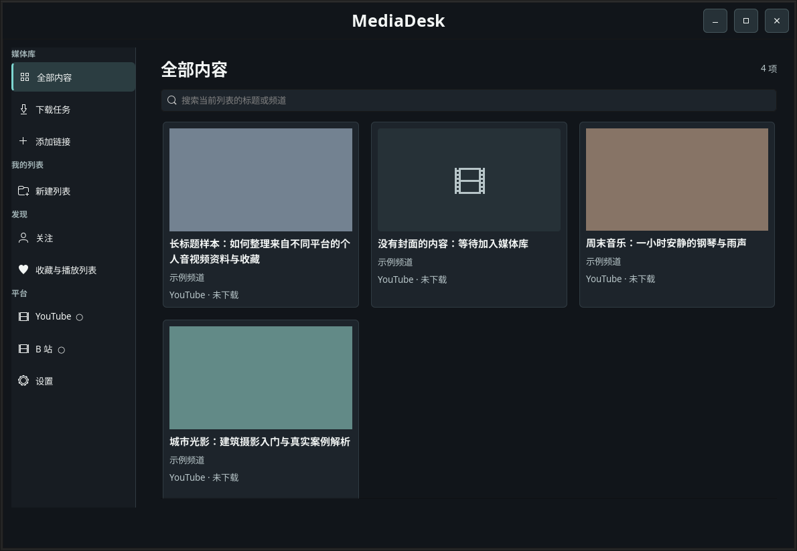
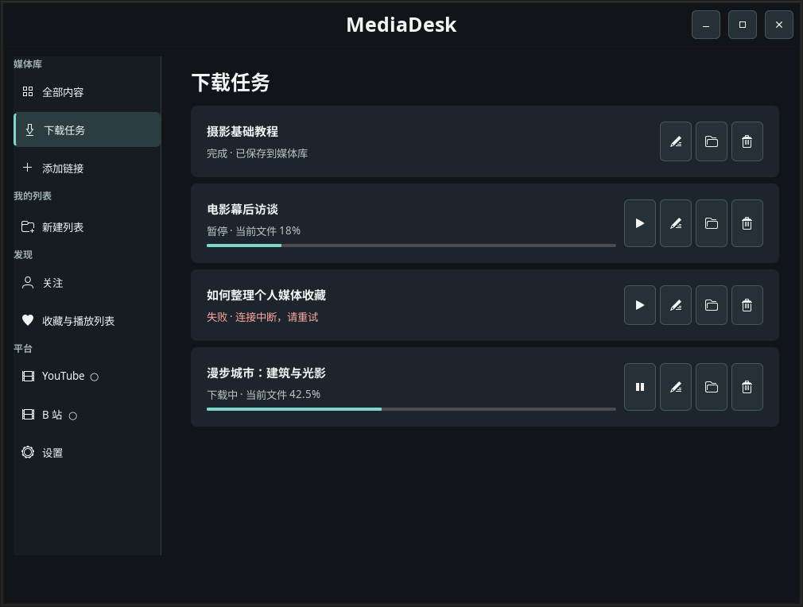

<p align="center">
  
</p>

<p align="center"></p>

<h1 align="center">MediaDesk</h1>

<p align="center"><strong>你的音视频，放在同一个地方。</strong><br>一个面向 Ubuntu 的个人媒体工作台，整理、下载和播放来自不同来源的内容。</p>

<p align="center">
  <a href="https://github.com/yuanhaorannnnnn/MediaDesk/releases/tag/v0.1.0"></a>
  
  
</p>

<p align="center"><a href="https://github.com/yuanhaorannnnnn/MediaDesk/releases/tag/v0.1.0"><strong>下载 0.1.0</strong></a> · <a href="#快速开始">快速开始</a> · <a href="#连接平台">连接平台</a> · <a href="README.desktop.md">桌面版说明</a></p>

---

来自 YouTube、B 站和本地文件的内容，可以在同一媒体库浏览，再按自己的主题整理成列表。条目保留来源、封面和原始介绍；未下载的内容也可以尝试在线播放。



<p align="center"><sub>媒体库界面 · 截图使用隔离环境和示例数据</sub></p>

## 现在可以做什么

| | |
| --- | --- |
| **收集与整理** | 添加 YouTube 或 B 站单视频链接，扫描选定的本地目录，用自建列表组织不同来源的内容。 |
| **关注与收藏** | 连接 YouTube 账号，读取订阅、点赞和播放列表；授权后读取 Chrome 中 B 站账号的关注和自建收藏夹。 |
| **在线播放与下载** | 可在线播放支持的内容，也可用 yt-dlp 下载；支持下载偏好、格式选择以及暂停、继续和失败重试。 |
| **观看与回看** | 用 libVLC 播放本地文件或支持的在线内容，支持音量、影院模式和全屏。 |
| **选择外观** | 深色、浅色，以及纳比派和新印象主义两套艺术风格主题。 |

<details>
<summary><strong>查看下载任务界面</strong></summary>
<br>



<sub>示例数据；进度百分比表示当前文件，不是整个任务的总进度。</sub>
</details>

## 快速开始

**系统要求：** Ubuntu 24.04 桌面。程序使用 X11；Wayland 桌面需要可用的 XWayland。其他系统和版本尚未验证。

1. 登录有权限的 GitHub 账号，从 [v0.1.0 Release](https://github.com/yuanhaorannnnnn/MediaDesk/releases/tag/v0.1.0) 下载 `mediadesk_0.1.0_all.deb` 和 `SHA256SUMS` 到同一目录。
2. 校验并安装。例如文件位于 `~/Downloads`：

   ```sh
   cd ~/Downloads
   sha256sum -c SHA256SUMS && sudo apt install ./mediadesk_0.1.0_all.deb
   ```

   校验通过时显示 `mediadesk_0.1.0_all.deb: OK`；失败时请重新下载，不要安装。`apt` 会从已配置的软件源安装依赖。若已安装同版本，使用 `sudo apt install --reinstall ./mediadesk_0.1.0_all.deb`。

3. 从应用菜单打开 **MediaDesk**，或在终端运行 `mediadesk`。首次引导中的账号连接、扫描和下载偏好可以跳过，之后再设置。

## 连接平台

| 来源 | 可用功能 | 账号准备 |
| --- | --- | --- |
| **YouTube** | 单视频导入、在线播放和下载；读取订阅、点赞、播放列表 | 连接账号需自行准备 Google OAuth 桌面客户端配置；不连接账号也可尝试添加公开链接。 |
| **B 站** | BV 单视频和分 P 导入、在线播放和下载；读取关注、自建收藏夹 | 在 Chrome 登录，并在 MediaDesk 中允许读取登录状态。旧版 yt-dlp 可能需要更新。 |
| **本地文件** | 扫描目录、整理和播放 | 无需账号。 |

账号配置、Cookie 权限和下载器选择见 [桌面版说明](README.desktop.md#账号和下载)。实际播放和下载取决于来源、账号权限、网络、yt-dlp 和本机依赖；B 站短链接目前尚未接入。

## 数据与卸载

默认数据库和下载媒体保存在 `~/.local/share/mediadesk/`；设置 `XDG_DATA_HOME` 时保存在 `${XDG_DATA_HOME}/mediadesk/`。Google OAuth 配置和令牌默认位于 `~/.config/youtube-readonly/`。账号凭据和媒体文件不进入项目仓库。

```sh
sudo apt remove mediadesk
```

卸载保留上述用户数据，也不会删除扫描过的外部文件。下载任务删除时默认保留文件；可选删除只识别部分扩展名，详见 [当前开发限制](README.desktop.md#当前开发限制)。

## 项目状态

`0.1.0` 是个人测试版，目前聚焦 Ubuntu 24.04、YouTube 和 B 站。跨设备同步、自动分类和更多平台适配仍未实现。

下载异常恢复依赖 yt-dlp 与来源支持；程序会根据可观察的风险选择快速流检查或更耗时的解码检查，但检查不能保证识别所有损坏。更详细的行为和已知限制见 [桌面版说明](README.desktop.md)。

## 从源码运行

本机已有依赖时，运行 `./run-desktop.sh`；构建 DEB 使用 `./packaging/build-deb.sh`，产物写入 `dist/`，版本号由 [VERSION](VERSION) 指定。

[GitHub Actions](https://github.com/yuanhaorannnnnn/MediaDesk/actions) 在 Ubuntu 24.04 上构建并安装 DEB，运行离线测试，检查启动、卸载和数据保留。自动检查不使用个人账号；真实桌面、声音和来源网站体验仍需实际验证。
